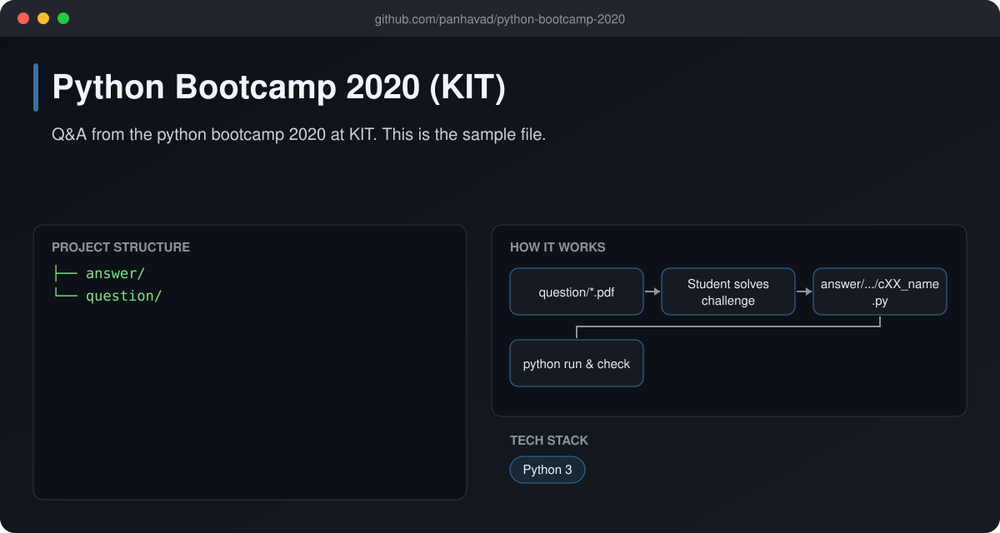
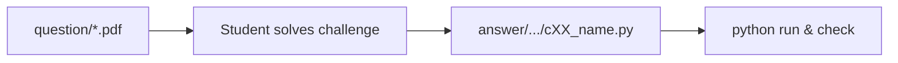

# Python Bootcamp 2020 (KIT)

  [](https://github.com/panhavad/python-bootcamp-2020/releases/latest)

Questions and **answers from the Python Bootcamp 2020** at Kirirom Institute of Technology (KIT). Beginner-friendly Python challenges covering printing, input, strings, lists, loops and simple web scraping.



## Features

- Weekly challenge PDFs in `question/`
- 20+ worked answers in `answer/`
- Short, commented solutions for beginners

## How it works



## Getting started

```bash
cd answer/dukpanhavad/challenges/week01
python c01_hello.py
```

## Download

Grab the packaged source from the [latest release](https://github.com/panhavad/python-bootcamp-2020/releases/latest).

## Tech stack

- Python 3

## Project structure

```text
python-bootcamp-2020/
├── answer/
├── docs/
├── question/
└── README.md
```
